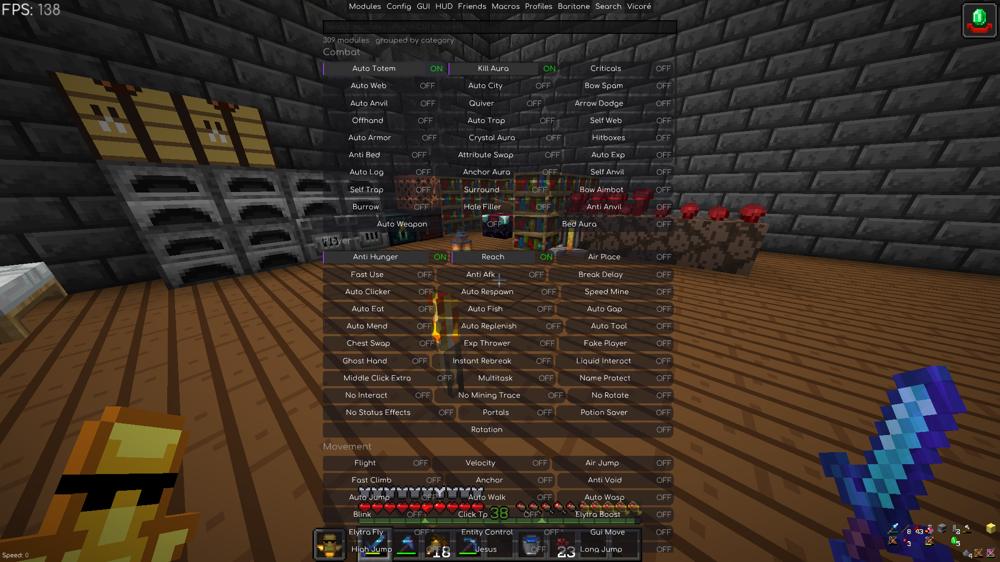

# Better Search
A Meteor Client addon (Minecraft 26.3) that adds a proper `Search` tab to the ClickGUI.





<br>

## Features

* Adds a **Search tab** next to Modules / Config / HUD in the Meteor menu.
* Empty search shows **all modules grouped by category**. Typing filters the list with fuzzy matching (typos and word order don't matter much).
* Matches names, descriptions, categories, aliases, setting names, and custom `@SearchTags` synonyms.
* Rows use Meteor's own module widgets, so they look and click exactly like the rest of ClickGUI (active styling included) — no custom drawing to break.
* **Learns what you use** — toggling a module bumps it up in future results. Stored in `meteor-client/better-search-usage.json`, delete it to reset.
* Toggling never reshuffles the list — order only changes when your search text does.
* Left-click toggles a module, right-click opens its settings right inside the tab (or the normal Meteor window if you turn that off).
* Keyboard: `Up/Down` to move, `Enter` to toggle, `Right` for settings, `Esc` to close.
* Command: `.better-search`, or `.bs` for short. `.bs <text>` lists matches, `.bs toggle <text>` toggles the best one.

## Install

1. Minecraft 26.3 with Fabric Loader 0.19.5 (Java 25).
2. Meteor Client for 26.3 in `mods/`.
3. Drop the `better-search-*.jar` from this repo's `build/libs/` into `mods/` too.
4. Open Meteor with `Right Shift`, click the **Search** tab. Or just press `Right-Ctrl`.

## Settings

Under ClickGUI → Better Search → `better-search`. The useful ones:

* `max-results` — how many rows when filtering (default 100, empty search always shows everything)
* `columns` — modules per line, 1–3
* `panel-width`, `row-gap`, `row-inner-gap` — sizing and density
* `show-category`, `show-status`, `inline-outline` — which bits to display
* `learn-usage` — turn off if you don't want usage-based ranking
* `inline-settings` — off = module settings open in a normal draggable Meteor window
* `draggable-panel` — shows a drag handle to move the panel around

For addon devs: annotate your modules with `@SearchTags({"alias", "synonym"})` from this mod and they'll show up under those words too.

## How to use it

* Bind Better Search to any key.
* Press the key.
* Better Search will appear.

## Build it yourself

Needs Java 25 (the minimum for Minecraft 26.3).

```bash
./gradlew build
```

Jar lands in `build/libs/`. For a live dev client:

```bash
./gradlew runClient
```

Pinned versions: MC 26.3, Fabric Loader 0.19.5, Gradle 9.8.1, Loom 1.18.4 (`net.fabricmc.fabric-loom`), Meteor `26.3-SNAPSHOT` (see `gradle/libs.versions.toml`).

Minecraft 26.x is unobfuscated: there is no Yarn/mappings step — the game ships with Mojang's names. Sources migrated with Loom's `migrateMappings`, and mod dependencies use plain `implementation` instead of `modImplementation`.

## License

CC0, do what you want.

